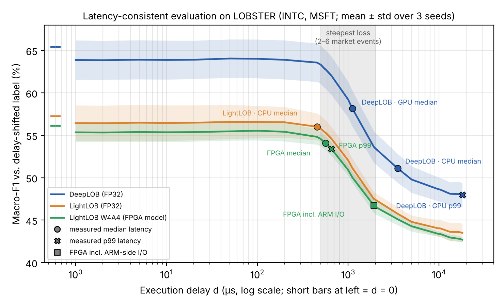

# deeplob-fpga

**Latency-consistent evaluation and FPGA deployment of deep limit order book (LOB) models.**

Deep LOB models such as DeepLOB are compared by accuracy against the price at the moment of the
decision. In trading, though, a model's order only reaches the market after its inference latency,
and a slower model therefore predicts a later future. This repository:

1. compresses DeepLOB-style models with quantisation-aware training (8 / 4 / 2 bits, Brevitas) and
   runs them **bit-exactly on an FPGA** (FINN, PYNQ-Z2);
2. scores every model against the label it would actually face, **shifted by its own measured
   latency** on FPGA, CPU and GPU (median and 99th percentile), on LOBSTER data with event timestamps;
3. tests latency-aware training, quantisation under distribution shift, and transfer across
   tick-size regimes.



*Macro-F1 against the delay-shifted label on LOBSTER (INTC, MSFT, 21 June 2012, last 20% of the
day as test set). Lines: mean over 3 seeds, bands: ±1 std; markers: each model at its measured
median (●) or p99 (✕) latency; ■ = FPGA including ARM-side I/O.*

## Main results

**Latency changes the ranking (LOBSTER, INTC + MSFT, 3 seeds, macro-F1 %).**

| Model / platform | F1 at d = 0 | F1 at own median latency | F1 at own p99 latency |
|---|---|---|---|
| DeepLOB, RTX 4090 GPU | 65.4 ± 2.4 | 58.2 ± 2.1 (1.11 ms) | 48.0 ± 1.4 (18.1 ms) |
| LightLOB, 1 CPU core | 57.2 ± 2.3 | 56.0 ± 1.6 (0.45 ms) | 43.6 ± 1.1 (13.2 ms) |
| LightLOB W4A4, FPGA accelerator | 56.1 ± 1.1 | 54.1 ± 0.8 (0.56 ms) | 53.4 ± 0.8 (0.65 ms) |


* DeepLOB's 8.2-point lead at zero delay shrinks to 2.2 points at measured median latency; at the
  99th percentile the FPGA leads by 5.4 points, because its latency is deterministic.
* The FPGA advantage needs data to reach the fabric directly: through the board's ARM host it falls
  to 46.7%.
* F1 is flat up to ~200 µs and drops steeply between 0.5 and 2 ms (2–6 market events).
* Latency-aware training (DeepLOB trained on labels shifted by 1,110 µs): +0.7 ± 2.3 points,
  within seed noise (per seed +2.0, −1.9, +2.1).
* Zero-delay labels are optimistic by up to 1.5 points (message bursts share one timestamp).
* Transfer between large-tick (INTC, MSFT) and small-tick (AAPL, GOOG, AMZN) stocks failed for every
  model (F1 0.10–0.27).

**Compression on FI-2010 (3 seeds, test macro-F1 %).**

| Model | k = 10 | k = 100 |
|---|---|---|
| DeepLOB (replication) | 72.2 | 78.2 |
| DeepLOB without LSTM | 40.8 | 71.5 |
| LightLOB FP32 | 43.9 | 74.2 |
| LightLOB W8A8 | 43.4 | 73.7 |
| LightLOB W4A4 | 43.6 | 73.8 |
| LightLOB W2A4 | 43.2 | 73.2 |
| LightLOB W2A2 | 28.5 | 23.9 ± 11.9 |
| LightLOB2 FP32 / W4A4 / W2A4 | 40.8 / 40.6 / 42.6 | 68.6 / 67.7 / 67.9 |

4-bit quantisation costs < 0.5 points; 2-bit *activations* collapse. Removing the LSTM costs 31
points at k = 10 but 6.7 at k = 100. The DeepLOB replication is below the published 83.4% at
k = 10 (this FI-2010 copy uses DecPre normalisation); closing that gap is open work. Quantised
models showed no extra fragility across FI-2010 test days (penalty 0.2 ± 0.4 points).

**FPGA (PYNQ-Z2, LightLOB W4A4, FI-2010 k = 10).** Identical predictions to PyTorch on 1,998 / 1,998
windows (max logit difference 4.8e-7); accelerator latency median 0.563 ms, p99 0.652 ms;
5,697 inferences/s; timing closes at ~70.5 MHz, run at 66.67 MHz. Details:
[`results/fpga/pynq_z2_light_w4a4.md`](results/fpga/pynq_z2_light_w4a4.md).

All numbers come from the files in [`results/`](results). They are a proof of concept:
one LOBSTER day, two stocks, one FPGA board.

## Repository layout

| Path | Purpose |
|---|---|
| `data.py` | FI-2010 loader (setup 2), z-scoring with training statistics, per-test-day parts |
| `lobster.py` | LOBSTER loader: windows, delay-shifted labels, per-ticker thresholds, time split |
| `models.py` | `DeepLOB`, `DeepLOBNoLSTM`, `LightLOB` (pixel layout), `LightLOB2` (features as channels, streaming-friendly); Brevitas QAT |
| `train.py` | Train and evaluate one configuration (`--dataset fi2010 / lobster`, `--bits`, `--abits`, `--delay-us`) |
| `rerun_seed.py` | Re-run a finished run with another seed and identical arguments |
| `latency_eval.py` | F1 vs delay, effective F1 at measured latencies, break-even latencies |
| `measure_latency.py` | Batch-1 CPU / GPU latency (median, p99, min) |
| `shift_eval.py`, `diag_run.py` | Quantisation penalty under shift; per-part F1 and confusion matrices |
| `measure.py`, `runutil.py` | Parameters, MACs, memory; shared helpers |
| `export_qonnx.py` | Export a quantised model to QONNX for FINN |
| `finn/build.py` | FINN build (board, clock, target fps via environment variables) |
| `board_testset.py`, `board_run.py` | Make a reference test set; check and time the bitfile on the board |
| `make_synthetic_lobster.py` | Random-walk LOBSTER files to check for look-ahead |
| `run_server.sh`, `run_all.sh`, `run_all.ps1` | FI-2010 sweeps (Linux server / Linux / Windows) |
| `scripts/run_lobster.sh` | The full LOBSTER experiment (3 seeds, latency-aware runs, evaluation, figure) |
| `scripts/aggregate_seeds.py`, `scripts/lobster_seed_summary.py`, `scripts/fig_latency.py` | Seed means, latency summary, figure |
| `notebooks/deeplob_fpga_colab.ipynb` | Training on Google Colab |
| `docs/` | [Server setup](docs/SERVER.md), [LOBSTER data and labels](docs/LOBSTER.md), [FINN build and board deployment](docs/FPGA.md) |
| `results/`, `figures/` | Result tables and figures reported above |

## Quick start

```bash
git clone https://github.com/Rafi-1410/deeplob-fpga.git && cd deeplob-fpga
python -m venv venv && source venv/bin/activate        # Windows: venv\Scripts\activate
pip install -r requirements.txt

# FI-2010 (public, from the DeepLOB repository)
curl -L -o data.zip https://raw.githubusercontent.com/zcakhaa/DeepLOB-Deep-Convolutional-Neural-Networks-for-Limit-Order-Books/master/data/data.zip
unzip -o data.zip -d data                              # Windows: Expand-Archive data.zip -DestinationPath data

# smoke test (minutes on a laptop CPU)
python train.py --model light --epochs 2 --train-stride 20 --test-stride 20 --tag smoke
```

## Reproduce

```bash
# FI-2010: all models, 3 seeds, k = 10 and 100 (GPU; skips finished runs)
SEEDS="0 1 2" HORIZONS="10 100" bash run_server.sh
python scripts/aggregate_seeds.py --runs "runs/*.json" --out results/fi2010/fi2010_seeds.csv
python shift_eval.py --runs "runs/*.json"

# latency of the trained models on this machine
python measure_latency.py --runs "runs/lobL_deeplob_fp32.json" "runs/lobL_light_fp32.json" --reps 1000

# LOBSTER (put the sample files in lobster/, see docs/LOBSTER.md)
bash scripts/run_lobster.sh

# FPGA: export, FINN build, board run -> docs/FPGA.md
```

Every run stores its full arguments in `runs/<tag>.json`, so any result can be re-run exactly
(`python rerun_seed.py <tag> <seed>`).

## Data

* **FI-2010** (Ntakaris et al., 2018), via the DeepLOB repository.
* **LOBSTER** sample day (Huang & Polak), 21 June 2012, level 10. LOBSTER data are not included and
  must not be redistributed; see [docs/LOBSTER.md](docs/LOBSTER.md).

## Limitations

One LOBSTER day and two stocks; latency-aware training and the FPGA comparison need multi-month
data and more seeds. GPU latencies were measured on a shared server. The FPGA is a Zynq-7020 driven
from Python on the ARM core, not a network-attached trading datapath. The DeepLOB replication on
FI-2010 is below the published result at k = 10.

## References

* Z. Zhang, S. Zohren, S. Roberts, "DeepLOB: Deep convolutional neural networks for limit order books," *IEEE Trans. Signal Process.*, 2019.
* A. Ntakaris et al., "Benchmark dataset for mid-price forecasting of limit order book data with machine learning methods," *J. Forecasting*, 2018.
* Y. Umuroglu et al., "FINN: A framework for fast, scalable binarized neural network inference," *FPGA*, 2017; Blott et al., "FINN-R," *ACM TRETS*, 2018.
* A. Pappalardo et al., Brevitas, <https://github.com/Xilinx/brevitas>.
* R. Huang, T. Polak, "LOBSTER: Limit order book reconstruction system," SSRN 1977207, 2011.
* C. C. Moallemi, M. Sağlam, "The cost of latency in high-frequency trading," *Oper. Res.*, 2013.

## Citation and licence

Code under the [MIT licence](LICENSE). If you use it, please cite via [`CITATION.cff`](CITATION.cff).
